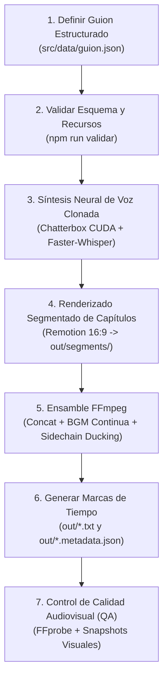

# AGENTS.md — AutoPNGTuber-LongVideos (Generador Autónomo de Videos Largos 16:9 para YouTube)

Guía de arquitectura, estándares audiovisuales, flujo de trabajo y modelos de datos para agentes y desarrolladores que trabajen en este repositorio.

---

## 1. Principios Fundamentales y Reglas de Oro

> 🚨 **REGLA DE AISLAMIENTO POR DEFECTO**:
> Este proyecto es independiente de `AutoPNGTuber` (Shorts). No modifiques archivos dentro del repositorio hermano `AutoPNGTuber` salvo cuando el usuario lo solicite explícitamente para portar mejoras entre ambos proyectos.

> 🖥️ **FORMATO Y RESOLUCIÓN WIDESCREEN 16:9**:
> - **Resolución**: **1920 × 1080** (Full HD horizontal, relación 16:9).
> - **Frecuencia de Cuadros**: 30 FPS estándar.
> - **Composición Horizontal**: Prohibido simplemente "estirar" encuadres verticales. El espacio horizontal debe aprovecharse con escenarios expansivos en 3 planos de profundidad, personajes actuando en el tercio izquierdo o central, y tarjetas infográficas o comparativas en el tercio derecho (`infografia_derecha`, `split_screen`).

> 🎙️ **VOZ CLONADA LOCAL (CHATTERBOX + FASTER-WHISPER)**:
> - **Motor Neural**: Inferencia en GPU (CUDA) mediante Chatterbox TTS condicionado con la voz de referencia `public/voices/alex.conds.pt`.
> - **Entorno de Inferencia**: Auto-despacho al entorno virtual de Python con soporte CUDA (`voice-lab/.venv`).
> - **Pipeline `v3_sentence_tailcut`**:
>   - Segmentación sintáctica por cláusulas naturales (límite de 135 caracteres, sin cortes abruptos entre verbos y objetos).
>   - Micro-fades anti-clic (6 ms / 12 ms) y compactación de silencios internos mayores a 280 ms a 150 ms.
>   - Poda estricta de colas residuales: Recorte del audio a 160 ms tras la última palabra pronunciada con fundido suave de 40 ms.
>   - Alineación temporal palabra por palabra mediante Faster-Whisper local (`float16` en CUDA) para subtítulos karaoke.

> 🗣️ **REGLA DE ORO DE DICCIÓN Y CIFRAS GRANDES (`normalizador_numeros.py`)**:
> - Los modelos neurales de TTS sufren tropiezos y balbuceos al procesar dígitos arábigos en bruto (ej. `1420`, `1977`, `300.000`).
> - **Normalización Fonética Automática**: `scripts/normalizador_numeros.py` expande automáticamente cualquier cifra, año, decimal o abreviatura técnica a palabras completas en español (`1420 megahercios` $\rightarrow$ *"mil cuatrocientos veinte megahercios"*, `1977` $\rightarrow$ *"mil novecientos setenta y siete"*, `1420.4 MHz` $\rightarrow$ *"mil cuatrocientos veinte punto cuatro megahercios"*).
> - **Dualidad Audio-Visual**: Mientras el narrador y los subtítulos utilizan palabras naturales para una dicción eufónica perfecta, los elementos visuales (`tituloVisual`, `InfographicCard`, rótulos) conservan las cifras en números grandes de alto impacto gráfico neo-brutalista.

> 🎵 **BANDA SONORA CONTINUA Y DUCKING SIDECHAIN**:
> - La música de fondo (`bgm.mp3`) es continua a lo largo de todo el video. **No se corta ni se reinicia entre capítulos**.
> - Ensamble final en FFmpeg con filtro `sidechaincompress`: la música se atenúa automáticamente cuando el narrador habla (ataque: 40 ms, relajación: 350 ms, ratio: 5:1, umbral: 0.03) y recupera su nivel durante pausas reflexivas.
> - Normalización de sonoridad estándar para YouTube: EBU R128 a **-14 LUFS** y pico máximo de **-1.5 dB**.

> ⏱️ **ESTRUCTURA DE CAPÍTULOS Y MARCAS DE TIEMPO (YOUTUBE TIMESTAMPS)**:
> - El guion se organiza en **Capítulos** (`capitulos`) y cada capítulo contiene sus respectivas **Escenas** (`escenas`).
> - Las marcas de tiempo de YouTube (`00:00 Introducción...`) se generan automáticamente midiendo la duración real en disco (`ffprobe`) de los segmentos renderizados, garantizando sincronización al segundo. Requisitos de YouTube: inicio obligatorio en `00:00`, mínimo 3 capítulos y duración mínima de 10 segundos por capítulo.

> 🏷️ **METADATOS DE PUBLICACIÓN Y HASHTAGS ESTRATÉGICOS**:
> - Al concluir la producción, `scripts/generar_capitulos.js` genera `{slug}_capitulos.txt`, `{slug}.metadata.json` y `{slug}.json`.
> - **Generación Inteligente de Hashtags**: Extrae entre 6 y 12 hashtags limpios sin números sueltos ni stop words (#ciencia, #documental, #geologia, #espacio...), combinando `meta.tags`, palabras clave de escenas (`palabrasClave`) y términos de nicho.
> - El JSON exporta los campos dedicados: `hashtags` (arreglo con prefijo `#`), `hashtags_string` (cadena continua para publicación) y `tags` (sin `#` para el campo de etiquetas de YouTube Studio).

> 🚫 **PROHIBICIÓN TOTAL DE LUCIDE EN OBJETOS (DISEÑO PROPIO OBLIGATORIO)**:
> - Queda estrictamente prohibido usar íconos de `lucide-react` o prefijos `"lucide:"` para props u objetos.
> - Todo objeto debe ser un prop ilustrado nativo de `src/stickman/propsLibrary.ts` con estética neo-brutalista (trazos negros gruesos de 4-6 px, sombras duras, volumen y colores saturados) o SVG inline (`"svg:<...>"`).

> 🎬 **DIRECCIÓN CINEMATOGRÁFICA Y ANIMACIÓN ARTICULADA CONTINUA (CERO DIAPOSITIVAS)**:
> - **Rig Esquelético IK/FK de 2 Huesos (`src/stickman/skeletalRig.ts`)**: El personaje interpola continuamente hombros, codos, muñecas, rodillas y tobillos entre poses (`prevPoseId` $\rightarrow$ `poseId`), con cabeza 2.5D (`lookOffset`), torso volumétrico con luz de recorte (`colorRim`) y sombra proyectada en los pies.
> - **Anclaje Léxico por Palabras (`desdePalabra` / `hastaPalabra`)**: Toda acción de personaje (`personajes[].acciones[].pasos`), estado de objeto (`objetos[].pasos`), plano de cámara (`planos`), cota vectorial (`cotasVectoriales`) y emisor de partículas (`emisoresParticulas`) se sincroniza con las marcas de tiempo palabra por palabra de Faster-Whisper.
> - **Micro-Planos y Profundidad de Campo (`planos`)**: Cada escena debe alternar de 2 a 4 cortes de cámara (`"general"`, `"plano_medio"`, `"primer_plano"`, `"sobre_hombro"`, `"detalle_mano"`) con desenfoque de fondo automático (`blurFondo`), siluetas en primer plano (*Over-The-Shoulder*, propiedad `ladoHombro`) e insertos macro de manos articuladas (`accionMano`).
> - **Cotas Vectoriales Diegéticas (`cotasVectoriales`) sobre Tarjetas Estáticas**: Prioriza flechas punteadas y etiquetas técnicas ancladas directamente a las coordenadas de las máquinas/objetos por encima de tarjetas laterales tipo diapositiva (`infografia`). Evita colocar `destinoX/Y` encima de la cabeza del personaje (`X ≈ 500-660, Y ≈ 280-420`); ubica las etiquetas sobre el espacio libre encima o a la derecha del objeto (`X ∈ [920, 1140], Y ∈ [220, 340]`).
> - **Hologramas Predictivos y Emisores Físicos**: Usa `esHolograma: true` + `trayectoriaSuelo` cuando el narrador plantee hipótesis o trayectorias, y `emisoresParticulas` + `iluminacionVolumetrica: true` coherentes con la física de la escena.

> 🛑 **PROHIBICIÓN ESTRICTA DE RECICLAJE TEMÁTICO Y PLANTILLAS CLÓNICAS (COHERENCIA NARRATIVA 1:1)**:
> - **Cero Escenarios Anacrónicos o de Otros Videos**: Queda prohibido reutilizar escenarios con textos o utilería específica de otros episodios (ej. NO usar `taller_inventor_victoriano` con sacos de `"ALGODÓN"`, `"ÁCIDO"` y `"ALCANFOR"`, ni `infraestructura_electrica` con postes de baquelita, ni `laboratorio` con pantallas `"DATA SPECTROMETRY"` en escenas históricas o al aire libre). **Debes crear de 4 a 6 nuevos componentes de escenario en `src/components/NarrativeStage16x9.tsx`** propios del tema del episodio (ej. astillero veneciano de 1638, cañón con puente colgante, horizonte de rascacielos modernos, etc.) y registrarlos en `src/types.ts` y `src/schema.ts`.
> - **1 Prop Multi-Estado Único por Concepto Visual (Mínimo 10–12 Props Nuevos por Video)**: Prohibido repetir el mismo `propId` en más de 2 escenas o usar un prop que no represente literalmente el sujeto hablado (ej. jamás mostrar un puente colgante cuando se habla del Burj Khalifa, ni un cubo geométrico cuando se habla de una lagartija gigante o un cable de 5 km). Cada escena debe mostrar el objeto exacto que describe la voz.
> - **Insertos de Mano (`accionMano`) y Partículas Específicos**: No reutilices `accionMano` de otros temas (como `"verter_acido"` o `"estirar_cadena"` de polímeros) si no corresponden literalmente a la acción. Si usas `detalle_mano`, añade primero la variante visual correspondiente en `HandInsertOverlay` (`src/components/CameraRig.tsx`) o usa planos `primer_plano` / `plano_medio` sobre el prop reactivo.
> - **Prohibido Copiar y Pegar Coordenadas Idénticas**: Varía la composición espacial entre escenas (personaje a la derecha en `x: 380` mirando a la izquierda hacia un objeto en `x: -240`, dos personajes interactuando, objetos que se desplazan o caen, y encuadres de cámara variados).
> - **Vibración y Oscilación Suave en Props (`Math.sin(f * 0.12..0.30)`)**: A 30 FPS, queda prohibido usar frecuencias angulares altas como `Math.sin(f * 1.5)` o `Math.sin(f * 2.5)` en `animatedSvg` de `src/stickman/propsLibrary.ts`, ya que producen un temblor frenético. Toda vibración, pulso u oscilación de tensión debe usar frecuencias suaves (`Math.sin(f * 0.12)` a `Math.sin(f * 0.30)`) y amplitudes moderadas (`1.0` a `2.5 px`).
> - **Jerarquía Z-Index con Infografías (Props Siempre al Frente)**: Cuando una escena incluya `infografia` junto con `objetos` o elementos visuales flotantes, los props (`capaZ: 28` / `zIndex >= 26`), personajes (`zIndex >= 22`), partículas (`zIndex: 32`) y cotas (`zIndex: 34`) deben renderizarse **siempre por delante** de la tarjeta infográfica (`zIndex: 14`). Usa `compacta: true` y `posicion: { x: 420, y: 10 }` en la infografía y coloca el prop central en `x ≈ -105` con zoom moderado (`<= 1.08`) para que no se solapen ni se recorten.

> 💰 **REGLA DE MONETIZACIÓN YOUTUBE MID-ROLL ($\ge$ 8:15 MINUTOS / 495+ SEGUNDOS)**:
> - Para habilitar anuncios *mid-roll* en YouTube con margen de seguridad, los videos largos deben durar **al menos 8 minutos y 15 segundos ($\ge 495\text{ s}$)** tras la compactación de silencios de Chatterbox (`v3_sentence_tailcut`, ritmo promedio de ~2.55 palabras/segundo).
> - **Fórmula de Extensión Obligatoria**:
>   - `meta.duracionObjetivo`: `[495, 570]`.
>   - **7 a 8 capítulos** (`capitulos`) y **14 a 16 escenas** (`escenas`) en total.
>   - **88 a 105 palabras habladas por escena** (**1,320 a 1,500 palabras totales** en la suma de todos los `escenas[].texto`, con números ya escritos en palabras).

---

## 2. Flujo de Producción End-to-End

Cada vez que se cree o actualice un video narrativo largo, sigue estos pasos en orden:



### Comandos Rápidos

| Comando | Acción |
| :--- | :--- |
| `npm run validar` | Valida el guion con Zod, comprueba recursos en catálogo y alerta de dicción en cifras. |
| `npm run tts` | Sintetiza voz clonada con `alex.conds.pt`, normaliza cifras y alinea palabras con Whisper. |
| `npm run tts:force` | Fuerza la regeneración omitiendo el caché SHA-256. |
| `npm run render:chapters` | Renderiza individualmente cada capítulo (`Capitulo-1`, etc.) en `out/segments/`. Reanuda si ya existen. |
| `npm run assemble` | Concatena capítulos con FFmpeg, integra BGM continua, aplica ducking y normaliza a -14 LUFS. |
| `npm run capitulos` | Calcula marcas de tiempo reales con `ffprobe` y genera el archivo `.txt` y `.metadata.json` para YouTube. |
| `npm run qa` | Valida 1920x1080 @ 30fps, códecs H.264/AAC, niveles de volumen y genera 4 fotogramas de inspección. |
| `npm run render` | **Pipeline Maestro**: Ejecuta los 6 pasos secuencialmente de forma desatendida. |
| `npm test` | Ejecuta la suite de pruebas automatizadas (esquema Zod, timestamps y motor TTS con GPU). |
| `npm run dev` | Inicia Remotion Studio en `http://localhost:3000` para previsualización interactiva. |

---

## 3. Esquema del Guion (`src/data/guion.json`)

El guion para videos largos se organiza jerárquicamente:

```json
{
  "meta": {
    "id": "doc_senal_wow",
    "slug": "misterio_senal_wow",
    "titulo": "El Enigma de la Señal Wow: ¿Contacto en 1977?",
    "premisa": "Análisis exhaustivo del evento radioastronómico más intrigante del siglo XX.",
    "gancho": "¿Recibimos en 1977 una transmisión extraterrestre que aún no logramos descifrar?",
    "categoria": "Science & Technology",
    "duracionObjetivo": [480, 600],
    "fps": 30,
    "dimensiones": { "width": 1920, "height": 1080 },
    "idioma": "es",
    "voz": "alex.conds.pt",
    "musicaPrincipal": "bgm/bgm.mp3",
    "volumenMusica": 0.12,
    "fuentes": [
      "Ehman, J. R. (1977). The 'Big Ear' Wow! Signal Analysis.",
      "Gray, R. H. (2012). The Elusive WOW."
    ],
    "tags": ["astronomia", "senal wow", "seti", "ciencia", "espacio"]
  },
  "capitulos": [
    {
      "id": "cap_1",
      "numero": 1,
      "titulo": "El Descubrimiento Inesperado",
      "resumen": "La noche del 15 de agosto de 1977 en el observatorio Big Ear.",
      "escenas": [
        {
          "id": 1,
          "texto": "En agosto de mil novecientos setenta y siete, un radiotelescopio en Ohio captó una extraña señal espacial treinta veces más potente que el fondo del cosmos.",
          "tituloVisual": "AGOSTO DE 1977",
          "layout": "panoramica_central",
          "composicionVisual": "plano_general",
          "escenario": "habitacion_noche",
          "transicion": "fundido_negro",
          "efectosCamara": ["drift"],
          "sfx": "sfx/sfx_whoosh.wav",
          "palabrasClave": ["agosto de 1977", "radiotelescopio", "treinta veces"],
          "poseId": "astronomy_telescope",
          "expresion": "analytical"
        }
      ]
    },
    {
      "id": "cap_2",
      "numero": 2,
      "titulo": "La Frecuencia 1420 Megahercios",
      "resumen": "Por qué la señal coincidía exactamente con la emisión del hidrógeno.",
      "escenas": [
        {
          "id": 3,
          "texto": "La transmisión se emitió exactamente en los mil cuatrocientos veinte megahercios, la frecuencia fundamental del hidrógeno en todo el universo.",
          "tituloVisual": "1420 MHZ",
          "layout": "infografia_derecha",
          "composicionVisual": "plano_medio",
          "escenario": "laboratorio",
          "transicion": "whip_right",
          "efectosCamara": ["drift"],
          "sfx": "sfx/sfx_whoosh.wav",
          "palabrasClave": ["mil cuatrocientos veinte megahercios", "hidrógeno"],
          "poseId": "explaining_pointing_up",
          "expresion": "eureka",
          "infografia": {
            "tipo": "dato_clave",
            "titulo": "Frecuencia Sagrada",
            "subtitulo": "Emisión del Hidrógeno Neutro (21 cm)",
            "valorPrincipal": "1420.4",
            "unidad": "MHz",
            "items": [
              { "etiqueta": "Señal Wow!", "valor": "Banda estrecha", "porcentaje": 100, "color": "#38BDF8" },
              { "etiqueta": "Ruido cósmico", "valor": "Banda ancha", "porcentaje": 20, "color": "#94A3B8" }
            ],
            "colorAcento": "#FFE600"
          }
        }
      ]
    }
  ]
}
```

### Campos Clave del Guion

| Campo | Nivel | Descripción |
| :--- | :---: | :--- |
| `meta.duracionObjetivo` | Raíz | Rango `[min, max]` en segundos. Para monetización mid-roll ($\ge$ 8:15 min): `[495, 570]`. |
| `meta.fuentes` | Raíz | Referencias científicas/bibliográficas que se exportan a la descripción de YouTube. |
| `capitulos[].numero` | Capítulo | Número secuencial (1, 2, 3...). Define el nombre de la composición Remotion (`Capitulo-{n}`). |
| `capitulos[].titulo` | Capítulo | Título oficial que aparecerá en la barra de progreso de YouTube y en el badge superior. |
| `escenas[].layout` | Escena | Distribución 16:9: `"panoramica_central"` (preferido para acción diegética), `"infografia_derecha"`, `"split_screen"`, `"primer_plano"`. |
| `escenas[].planos` | Escena | Secuencia de micro-cortes de cámara (`"general"`, `"plano_medio"`, `"primer_plano"`, `"sobre_hombro"`, `"detalle_mano"`) con `blurFondo`, `zoom` y `accionMano`. |
| `escenas[].cotasVectoriales` | Escena | Etiquetas y líneas punteadas diegéticas (`origenX/Y` $\rightarrow$ `destinoX/Y`) sincronizadas con `desdePalabra`/`hastaPalabra`. |
| `escenas[].emisoresParticulas`| Escena | Sistemas de partículas balísticas (`"chispas_quimicas"`, `"gotas_acido"`, `"vapor_presion"`, `"eslabones_polimero"`, `"fragmentos_marfil"`). |
| `escenas[].personajes` | Escena | Actores en escena con `acciones[].pasos[]` sincronizados por palabra (`procedural`, `esHolograma`, `colorRim`, `trayectoriaSuelo`). |
| `escenas[].objetos` | Escena | Props interactivos y máquinas con `pasos[]` multi-estado (`estado`, `posicion`, `escala`, `capaZ`). |
| `escenas[].eventosSfx` | Escena | Efectos de sonido puntuales disparados a mitad de escena mediante `desdePalabra` o `enSegundo`. |
| `escenas[].infografia` | Escena | Tarjeta neo-brutalista opcional (`dato_clave`, `comparacion`, `tarjeta_concepto`, `grafico_barras`), soporta `compacta: true` y ventana temporal. |
| `escenas[].escenario` | Escena | Fondo vectorial 16:9 (`laboratorio`, `espacio_profundo`, `lunar`, `superficie_marte`, `habitacion_noche`, `abismo_oceanico`, `red_subterranea`, `cielo_dia`, `vacio`). |
| `escenas[].efectosCamara`| Escena | Modificadores cinemáticos: `["drift"]` (micro-zoom lento), `["shake"]`, `["punch"]`, `["pan_right"]`, `["pan_left"]`. |
| `escenas[].transicion` | Escena | Entrada cinemática: `"fundido_negro"`, `"zoom_in"`, `"whip_right"`, `"whip_left"`, `"corte"`. |

---

## 4. Arquitectura de Componentes Visuales (16:9)

```text
src/
├── Root.tsx                      # Registra composiciones independientes Capitulo-{n} y Master
├── types.ts                      # Interfaces TypeScript estrictas (CapituloGuion, EscenaGuion, PlanoCamara, etc.)
├── schema.ts                     # Esquema Zod completo para validación estática del guion
├── components/
│   ├── Scene.tsx                 # Coordinador maestro 1920x1080 (DoF, planos, personajes, objetos, HUD)
│   ├── NarrativeStage16x9.tsx    # Escenarios ilustrados SVG con 3 planos de profundidad y parallax
│   ├── CameraRig.tsx             # Rig de cámara (micro-planos, OTS foreground, insertos macro de manos)
│   ├── DiegeticCallout.tsx       # Cotas vectoriales diegéticas y flechas de trayectoria en el suelo
│   ├── ParticleEmitter.tsx       # Emisores de partículas con física balística y rayos de luz volumétricos
│   ├── InfographicCard.tsx       # Tarjetas de datos, comparativas y gráficos de barras neo-brutalistas
│   ├── SplitScreen.tsx           # Vista comparativa dividida en dos paneles horizontales
│   ├── ChapterHeader.tsx         # Badge superior izquierdo discreto con título y progreso de capítulo
│   ├── WordSubtitles.tsx         # Subtítulos en tercio inferior (y ≈ 920-1020), bloques de 4-5 palabras
│   ├── Stickman.tsx              # Personaje con rig IK/FK continuo, cabeza 2.5D, rim light y modo holograma
│   └── SceneObject.tsx           # Props ilustrados multi-estado con animación progresiva por paso
└── stickman/
    ├── skeletalRig.ts            # Solver IK de 2 huesos, interpolación continua de articulaciones y cabeza 2.5D
    ├── actionSequences.ts        # Anclaje temporal por palabras (desdePalabra/hastaPalabra) y segundos
    ├── composites.ts             # Evaluador de pasos de personaje, caminata procedural y manipulación
    ├── bodyPoses.ts              # Catálogo de poses corporales del Stickman
    ├── expressions.ts            # 24 expresiones faciales
    ├── propsLibrary.ts           # Props ilustrados propios y máquinas reactivas (prohibido Lucide)
    └── catalog.ts                # Buscador semántico de recursos
```

### Desacoplamiento de Cámara y HUD
El `CameraRig` opera exclusivamente sobre el lienzo cinemático (escenario, personajes y props). Los elementos de interfaz (el rótulo de capítulo `ChapterHeader` y los subtítulos `WordSubtitles`) se renderizan en una capa superior fija (`z-index: 50`), garantizando que **jamás se corten o salgan del cuadro** durante paneos o acercamientos dramáticos.

---

## 5. Pipeline de Audio y Renderizado Segmentado

Para videos largos de 8 a 10 minutos, renderizar todo el proyecto en una única llamada de Remotion provocaría agotamiento de memoria o fallos irrecuperables. El pipeline divide el trabajo en fases seguras:

1. **Segmentación**: Cada capítulo se renderiza de forma aislada a `out/segments/capitulo_{n}.mp4`.
2. **Reanudación Automática**: Si el proceso se interrumpe, `render_segments.js` detecta los segmentos válidos existentes y sólo procesa los faltantes (salvo que se use `--force`).
3. **Ensamblado con FFmpeg**: `assemble_video.py` utiliza el demuxer de concatenación de FFmpeg para fusionar el video sin re-codificación pesada.
4. **Sidechain Ducking**: El audio de la voz se inyecta como disparador de compresión sobre la pista de BGM continua.
5. **Marcas de Tiempo Exactas**: `generar_capitulos.js` lee la duración precisa de cada archivo de video generado con `ffprobe` y escribe el índice oficial de YouTube en `${slug}_capitulos.txt`.

---

## 6. Estructura de Directorios

```text
AutoPNGTuber-LongVideos/
├── AGENTS.md                   # Este documento de arquitectura y directrices
├── package.json                # Dependencias independientes (Remotion 4, Tailwind, Zod)
├── remotion.config.ts          # Configuración de Remotion (1920x1080, Chromium flags)
├── public/
│   ├── audios/                 # Audios MP3 generados por scripts/tts_engine.py
│   ├── bgm/                    # Música de fondo continua (bgm.mp3)
│   ├── sfx/                    # Efectos de sonido WAV/MP3
│   └── voices/                 # Archivos de acondicionamiento de voz (.conds.pt)
├── out/
│   ├── segments/               # Segmentos independientes (capitulo_1.mp4, capitulo_2.mp4...)
│   ├── snapshots/              # Fotogramas clave de inspección de calidad
│   ├── {slug}.mp4              # Video final ensamblado en 1080p con ducking
│   ├── {slug}_capitulos.txt    # Marcas de tiempo listas para pegar en YouTube
│   └── {slug}.metadata.json    # Metadatos completos (título, descripción, tags, fuentes)
├── scripts/
│   ├── normalizador_numeros.py # Conversión fonética de cifras a español para TTS
│   ├── tts_engine.py           # Motor Chatterbox CUDA + Faster-Whisper + normalizador
│   ├── render_segments.js      # Renderizado de capítulos independientes con Remotion
│   ├── assemble_video.py       # Ensamble FFmpeg, loop de BGM continua y ducking sidechain
│   ├── generar_capitulos.js    # Cálculo de marcas de tiempo YouTube y exportación de metadata
│   ├── qa_video.js             # Verificación técnica de resolución, códecs, volumen y snapshots
│   ├── validar_guion.js        # Validador de esquema Zod, catálogos y lint de dicción
│   └── pipeline.js             # Orquestador maestro de todas las fases
├── src/
│   ├── data/
│   │   ├── guion.json          # Guion activo
│   │   ├── guion_ejemplo_completo.json # Ejemplo realista de documental largo
│   │   └── poses.json          # Catálogo completo de poses y props
│   └── ...
└── tests/
    ├── test_schema.js          # Pruebas de esquema Zod
    ├── test_timestamps.js      # Pruebas de reglas de YouTube para marcas de tiempo
    ├── test_tts.py             # Pruebas del motor TTS clonado y normalizador de cifras
    └── test_runner.js          # Ejecutor de la suite completa (npm test)
```

---

## 7. Checklist de Verificación para Agentes

Antes de dar por finalizada la producción de un video largo, el agente debe verificar:

- [ ] **Aislamiento**: `git -C "../AutoPNGTuber" status` no muestra modificaciones causadas por esta tarea.
- [ ] **Validación**: `npm run validar` concluye con `Guion 100% válido`.
- [ ] **Duración Monetizable ($\ge$ 8:15 min)**: La duración ensamblada final es $\ge 495\text{ segundos}$ (`8m 15s+`) para garantizar anuncios *mid-roll* en YouTube.
- [ ] **Dicción Fonética**: Las cifras y años se pronuncian con fluidez natural sin distorsiones ni lecturas literales erróneas.
- [ ] **Marcas de Tiempo**: El archivo `_capitulos.txt` comienza en `00:00`, tiene al menos 3 capítulos y concuerda con la duración final.
- [ ] **Límites de Audio**: `npm run qa` confirma niveles de audio promedio entre -18 y -14 dB sin recortes (clipping) en picos.
- [ ] **Dirección Cinematográfica Activa**: Las escenas utilizan micro-planos (`planos` con `blurFondo`, `sobre_hombro`, `detalle_mano`), cotas vectoriales diegéticas (`cotasVectoriales`) dentro del margen seguro (`[420, 1140]`) y acción articulada continua sincronizada con `desdePalabra`/`hastaPalabra`.
- [ ] **Subtítulos Visibles**: Los bloques de texto no exceden los márgenes seguros y la palabra activa se resalta en `#FFE600`.
